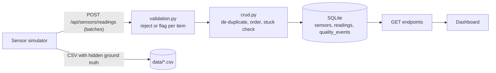

# Design document

Status: this document grows phase by phase. Sections are added when the part they describe
is designed, so everything written here matches code that exists.

## 1. What is monitored, and why these signals

The conveyor is modelled as a fixed structure 5 km long (configurable) with 10 sensor
stations (configurable) at fixed kilometre positions. Each station reports five signals
every 5 seconds.

| Signal | Unit | Why it is monitored |
|--------|------|---------------------|
| Temperature | °C | Failing idler bearings and slipping drives turn mechanical energy into heat. Heat is a late but reliable sign, and an overheated idler is a fire risk on a belt carrying coal or ore dust. |
| Vibration | mm/s RMS | Bearing wear shows in vibration before it shows in temperature. It is the earliest of the five signals for idler and pulley faults. |
| Belt speed | m/s | Belt speed falling below drive speed, or fluctuating, means the belt is slipping on the drive pulley. |
| Belt load | % of rated | Load explains the other signals: more material means more current and more heat. Without it, a loaded belt looks like a faulty one. Sustained overload is also a failure cause in itself. |
| Motor current | A | Current is the drive's effort. Rising current at constant load means added friction (seized idlers, misalignment, slip). |

### Operating limits

One table of limits is defined in `backend/config.py` and used by the simulator, the
backend and the predictor.

| Signal | Typical normal | Warning limit | Failure limit | Fails by |
|--------|----------------|---------------|---------------|----------|
| Temperature | 37–71 °C | 75 °C | 95 °C | rising |
| Vibration | 1.7–3.4 mm/s | 7.1 mm/s | 11.0 mm/s | rising |
| Belt speed | 3.9–4.1 m/s | 3.6 m/s | 3.2 m/s | falling |
| Belt load | 46–93 % | 100 % | 120 % | rising |
| Motor current | 207–311 A | 340 A | 400 A | rising |

"Typical normal" is the minimum-to-maximum range of healthy readings in a 48-hour
simulator run (seed 42).

Where the numbers come from:

- The vibration limits follow the scale of the ISO 10816 vibration-severity zones, where
  7.1 and 11 mm/s RMS are zone boundaries for large machines. They are used here as
  plausible magnitudes, not as a standards assessment of any real machine.
- The other limits are round numbers chosen to be plausible for a large belt drive. They
  are assumptions. On a real installation they would come from the equipment
  manufacturer's data and the site's failure history.

"Failure limit" is the level at which the simulator declares the component failed, and the
level the predictor extrapolates trends to.

## 2. Assumptions made where the brief was unclear

| # | Assumption | Reason |
|---|------------|--------|
| A1 | Every station reports all five signals, including motor current. | The brief lists the five signals per reading. On a real conveyor current is measured only at drives. A multi-kilometre belt often has more than one drive, but not one per station. The simulator keeps the brief's uniform schema; the design treats current and speed as "the drive conditions seen at this station". |
| A2 | Station positions are evenly spaced, at the centre of equal segments (0.25, 0.75, … 4.75 km by default). | The brief gives no layout. Even spacing is the simplest layout that covers the belt. |
| A3 | The belt loop is twice the conveyor length plus 30 m of pulley wrap (10 030 m by default). | The belt runs out on the carry side and back on the return side. The exact figure only matters for the vision registry, and it is configurable. |
| A4 | Nominal belt speed is 4.0 m/s, so one lap takes about 42 minutes. | Within the usual range for long overland conveyors. It sets how often the camera sees the same piece of belt. |
| A5 | Timestamps are UTC, ISO 8601. | Avoids daylight-saving and time-zone ambiguity between simulator, backend and dashboard. |
| A6 | The belt has one identifiable reference marker (a known splice or a purpose-made mark) that passes the camera once per lap. | Position along a loop needs a zero. Real belts have many splices; picking out one of them is treated as given. |
| A7 | The belt-condition camera is on the return side, looking at the carry cover. | On the carry side the belt is covered by material. |

## 3. Failure modes considered

| Mode | Kind | What the simulator does | Signal that reaches its failure limit |
|------|------|-------------------------|---------------------------------------|
| Idler / bearing wear | gradual | Vibration rises first. Temperature starts to follow after about a third of the fault's life. Current rises slightly. | Vibration (11 mm/s) |
| Belt slip / drive problem | gradual | Mean belt speed sags and fluctuates more. Current rises. Slight heating. | Speed (3.2 m/s) |
| Overload | gradual | Load goes to about 115 % early and stays. Current is high because load is high. Temperature climbs for as long as it lasts. | Temperature (95 °C) |
| Blockage | sudden | For 1 to 5 minutes: load jumps, current jumps with it, speed drops. | none (not predictable) |
| Spike | sudden | One reading of one signal is 1.6 to 2.5 times its true value. | none (not predictable) |

A gradual fault lasts 4 to 24 simulated hours from start to failure. After the failure the
signals stay at failure level for 20 to 60 minutes (the repair), then the station is healthy
again. Growth follows `progress ** shape` with a random shape per fault, so some faults drift
almost linearly and others start slowly and accelerate.

Not modelled: belt mistracking, pulley lagging wear, gearbox faults, and faults that spread
from one station to the next. Each would need a signal the brief does not list (edge
position, acoustic, oil) or a model of coupling between stations.

### Messy data produced by the simulator

Missing field, NaN, physically impossible value, wrong type (text in a numeric field),
duplicate reading, late (out-of-order) reading, a stuck signal repeating one value, and a
station that goes silent. The default is 3 % of readings with a point corruption, plus
occasional stuck and silent episodes. How the backend treats each one is in section 5.

## 4. Architecture so far

Sections on prediction, vision and the full architecture diagram are added with those phases.

## 5. How messy data is handled at the backend

Every incoming reading ends in exactly one of four outcomes, and all but the first leave a
row in the `quality_events` table, with the reason and the offending payload.

| Outcome | When | Stored? |
|---------|------|---------|
| accepted | nothing wrong | yes |
| flagged | the reading can be placed in time and has at least one usable signal | yes; bad signals are NULL |
| rejected | no sensor id, no usable timestamp, no usable signal, or unknown sensor with no position | no |
| duplicate | a reading for the same sensor and timestamp already exists | no; the first one is kept |

| Problem in the data | What the backend does |
|---------------------|-----------------------|
| Missing signal, or null | Signal stored as NULL, flagged `missing_field` |
| NaN or infinity | NULL, flagged `nan` |
| Value outside what the instrument can report (for example -999 °C) | NULL, flagged `out_of_range` |
| Text in a numeric field | NULL, flagged `wrong_type`. Plain numeric text ("45.2") is used and still flagged |
| Missing or unreadable timestamp | Rejected: the reading cannot be placed |
| Duplicate reading | Not stored again, logged |
| Out-of-order reading | Stored at its own timestamp, marked `arrived_late`, logged. History queries always sort by reading time |
| Stuck sensor | From the 6th identical value in a row, flagged `stuck`; value kept but ignored by analysis |
| Silent station | Status becomes `offline` after 60 s without any message (arrival time) |

`GET /api/data-quality` returns totals, counts per sensor and per reason, and the most
recent log entries.

Analysis runs inside the ingest request (added in phase 4). At 10 stations and one reading
every 5 seconds that is two readings per second, which a single process handles easily. At
real scale (thousands of sensors, or sub-second sampling) ingest would write to a queue,
analysis would run in separate workers, and readings would go to a time-series database
instead of SQLite.

## 6. How anomaly detection works

Every stored reading is prepared the same way in training, evaluation and live operation
(`ml/preprocessing.py`):

1. **Imputation.** A missing or blanked value takes the station's last valid value if that
   is at most 12 readings (1 minute) old; otherwise the median of healthy training data.
2. **Baseline.** A linear fit on healthy data predicts temperature, vibration, speed and
   current from belt load and hour of day. The residual (measured minus expected) is what a
   fault changes; load swings and the daily temperature cycle are removed.
3. **Rolling features** over the station's last 360 readings (30 minutes): mean, standard
   deviation and slope of each signal, the raw values, and the mean residual. 24 features.

A reading is anomalous if any of three rules fires (`ml/predict.py`):

| Rule | Fires when | Catches |
|------|------------|---------|
| Forest | Isolation Forest score is below the lowest 0.2 % of healthy training scores | unusual combinations of signals |
| Limit | a signal is beyond its warning limit | anything already outside operating limits |
| Drift | the 30-minute mean residual of a signal is outside the healthy band by 4 standard deviations | slow drift of one signal, well before a limit |

The forest is trained on healthy readings only. The drift rule was added after testing
showed that the forest does not react to a single signal leaving its training range
(DECISIONS D31).

An **anomaly** is opened after three anomalous readings in a row, or immediately at
severity High or Critical. It carries a type (the signals that drove it, strongest first),
the severity of its worst reading, the station and kilometre, and its start time. It stays
active until the station has been normal for 120 seconds of data time, then it is cleared.

## 7. How failure prediction works: what, where, when

`ml/risk.py` runs once a minute (data time) per station on the last 3 hours of readings.

- **Where** is the station: its id and kilometre position.
- **What.** Each gradual failure mode has a primary signal: vibration for idler/bearing
  wear, belt speed for slip, temperature under sustained load above 100 % for overload. A
  mode is a candidate when its primary signal has a clear trend towards the failure limit
  or is already outside the healthy band. Among candidates the one whose primary signal has
  moved furthest towards its limit is reported.
- **When.** A straight line is fitted to one-minute medians of the primary signal's
  residual. The trend is used only if it heads for the limit, fits (R² at least 0.5) and
  has covered at least 8 % of the distance from normal to failure. The time to the limit is
  reported as a window: the early end uses the faster of "slope plus two standard errors"
  and the slope of the most recent third; the late end uses the slope minus two standard
  errors. If there is no usable trend the answer is "no estimate".
- **Confidence.** High: R² at least 0.85 on at least 2 hours of history. Medium: R² at
  least 0.7 on at least 1 hour. Otherwise Low.
- **Risk** is the highest of: time (early end within 2 h Critical, 8 h High, 24 h Medium),
  level (how far the signal has moved towards the limit), and the anomaly record of the
  last hour. Every prediction stores a sentence-form reason with the numbers used.

Station status, most urgent first: `offline`, `predicted failure` (risk High or Critical),
`abnormal` (an anomaly is active), `normal`.

Measured results and their limits are in [evaluation_results.md](evaluation_results.md).

## 8. The continuous-loop problem (analysis before any vision code)

The brief says only: "The belt is a continuous loop, and your vision component has to
account for that." This section works out what follows from that sentence. Numbers use the
defaults: a 5 km conveyor, a belt loop of 10 030 m (A3), belt speed 4 m/s, so one lap takes
about 2 507 s, or 42 minutes.

### 8.1 Two reference frames

Sensor stations are bolted to the structure. Their position is a kilometre along the
conveyor and never changes. Damage is on the belt, and the belt moves. A tear seen by a
camera at kilometre 0.1 is at kilometre 2.6 ten minutes later and on the return side
twenty minutes after that. "Where is the damage" therefore has no answer in conveyor
kilometres. It has an answer in **belt coordinates**: metres along the loop from a fixed
reference mark on the belt, from 0 to 10 030.

Consequences for the design:

- Damage is never attached to a sensor station, and the vision tables have no station id.
- The dashboard shows damage on its own axis (position along the belt loop), separate from
  the station line.
- The camera is the only fixed thing in the vision system. It has a station-frame position,
  which matters for one purpose only: telling maintenance when a given piece of belt will
  next pass an access point.

### 8.2 Repeat sightings

A fixed camera sees every point of the belt once per lap. One tear produces one detection
every 42 minutes, 34 a day. Counting detections would report 34 "damages" a day for a
belt with one tear, growing without limit. The quantity to report is **unique damages**,
which requires deciding, for each detection, whether it is something already known.

The same damage also appears more than once *within* a lap: at 4 m/s a camera with a
1 m field of view needs at least 4 frames per second to cover the belt without gaps, and
any overlap between frames shows the damage twice. So de-duplication is needed inside a
lap as well as across laps.

### 8.3 The useful side of repetition

Each lap is a new measurement of the same damage, taken by the same camera from the same
angle. That gives three things a single inspection cannot:

- **Growth.** The size of the damage per lap is a time series. A tear that lengthens lap
  after lap is the urgent one, whatever its size today.
- **Confirmation.** A detection seen once and never again was probably dirt, a shadow or
  a false positive. Requiring a second lap before treating damage as confirmed removes most
  single-frame errors at the cost of a 42-minute delay.
- **Disappearance.** Damage that stops being seen has been repaired, covered (dirt,
  carry-back, water), missed by the detector, or lost by the position estimate. These
  cannot be told apart from images alone, so the entry is marked "not re-observed" after N
  laps and kept. It becomes active again if the damage reappears.

### 8.4 Position estimation and drift

Belt position at the camera = (distance travelled since the reference mark passed the
camera) modulo the loop length. Distance travelled is the integral of belt speed over time.

Sources of error, all of which accumulate:

- **Speed error.** A 1 % error in measured speed is 100 m of position error per lap.
- **Slip.** A drive-pulley speed measurement over-reads when the belt slips. The speed must
  come from a wheel riding on the belt, not from the motor.
- **Loop length.** The belt stretches with load and temperature and the take-up moves. An
  error in the assumed loop length shifts every position by that amount each lap.
- **Stops and reversals.** Integration must use signed speed; a stopped belt shows the same
  metre of belt for as long as it stands.

Uncorrected, the error after a day (34 laps) at 1 % is 3.4 km: a third of the loop.
Dead reckoning alone is unusable beyond a few laps.

**The splice as a zero marker.** The belt joint passes the camera once per lap. Each time
it is seen, the position is reset to zero and the lap counter increments, so error no
longer accumulates across laps. Within a lap the error grows with distance from the
splice (1 % of up to 10 km is still 100 m at the far end), so:

- the matching tolerance should grow with distance travelled since the last marker, and
- the time between two splice sightings gives the true lap time, from which the speed
  scale (or loop length) is corrected for the next lap.

Complications:

- A belt this long is made of many rolls and has many splices, not one. One of them (or a
  purpose-made mark, or an RFID tag vulcanised into the belt) must be identifiable as *the*
  reference. This design assumes one identifiable reference marker per lap (assumption A6).
- **A splice looks like damage** to a detector: a straight line across the belt, often with
  a raised edge. Known splice positions must be excluded from the damage registry, and a
  splice that changes appearance is itself a maintenance finding (splice failure is a
  common way belts break).
- If the marker is missed on one lap, the system falls back to dead reckoning for that lap
  and the tolerance widens.

### 8.5 Same damage or new damage?

A detection is matched against the registry on three things together:

1. **Position along the belt**, within a tolerance.
2. **Class.** A tear does not become a hole between laps (the detector's class confusion
   makes this imperfect, see below).
3. **Appearance** of the cropped region.

Why position alone is not enough: two different defects can sit within the position
tolerance of each other, and with drift the tolerance has to be metres wide. Why
appearance alone is not enough: the same damage looks different every lap (dust, wet belt,
lighting, material stuck in it, and real growth), and two cracks can look alike.

Further rules that follow:

- **One to one per lap.** A registry entry can be matched by at most one detection per lap,
  and one detection by one entry. Otherwise two neighbouring tears collapse into one.
- **Position across the belt** (left edge, centre, right edge) is a second coordinate that
  is cheap and stable, and separates defects that are close along the belt.
- **Growth changes appearance and size on purpose.** The appearance check has to tolerate a
  damage that is larger than last lap, and must compare against the *latest* sighting, not
  the first.
- **Merging and splitting.** Two tears that grow into one, or one detection box that
  becomes two, break the one-to-one rule. This is not solved here.

### 8.6 What the camera cannot see

- One camera sees one face of the belt. Damage on the other cover, or inside the carcass,
  is invisible to it.
- On the carry side the belt is under material. A camera for belt condition belongs on the
  return side, after the discharge and a belt cleaner, where the carry cover faces down and
  is as clean as it gets.
- Pixel size to millimetres needs camera calibration. Without it, growth can be reported
  only relative to the first sighting, not in millimetres.

### 8.7 What will be built, and what stays unsolved

Built in `vision/belt_registry.py` (after this analysis is agreed):

- Every detection gets a belt-loop position and a lap number.
- Matching by position within tolerance, same class and an appearance check on the crop;
  one-to-one per lap; match against the latest sighting.
- A match updates the entry (last seen, lap count, size history); no match creates one.
- Entries not seen for N laps are marked "not re-observed", never deleted, and can return.
- The dashboard shows unique damages with a growth trend, not raw detections.
- A reference-marker event resets position and increments the lap.

Simulated, and said so: the dataset is unrelated still images, not footage of one belt.
`scripts/seed_demo.py` places a set of images at fixed belt positions and replays them over
several laps with changes in brightness, shift and blur, with speed jitter and with clean
frames in between. This tests the registry logic. It does not test whether the appearance
check survives real dust, real lighting changes or real growth.

Unsolved without a real encoder, real camera calibration and real multi-lap footage:

- Real drift behaviour and the right tolerance. The tolerance here is a configured number.
- Detecting the reference splice from images. In the simulation the marker event is given.
- Growth in physical units.
- Merging and splitting of damages, and damage wider than one frame.
- Belt repairs that change the loop length (a section cut out and re-spliced shifts every
  position after it).
- Class confusion by the detector between laps.
